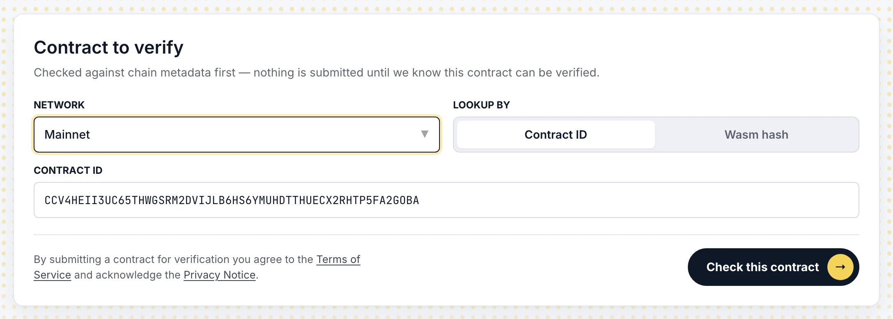
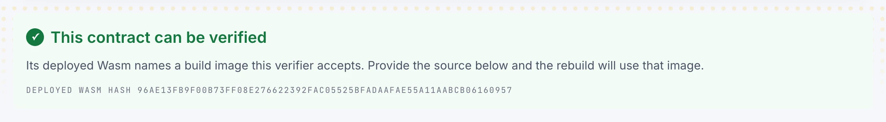
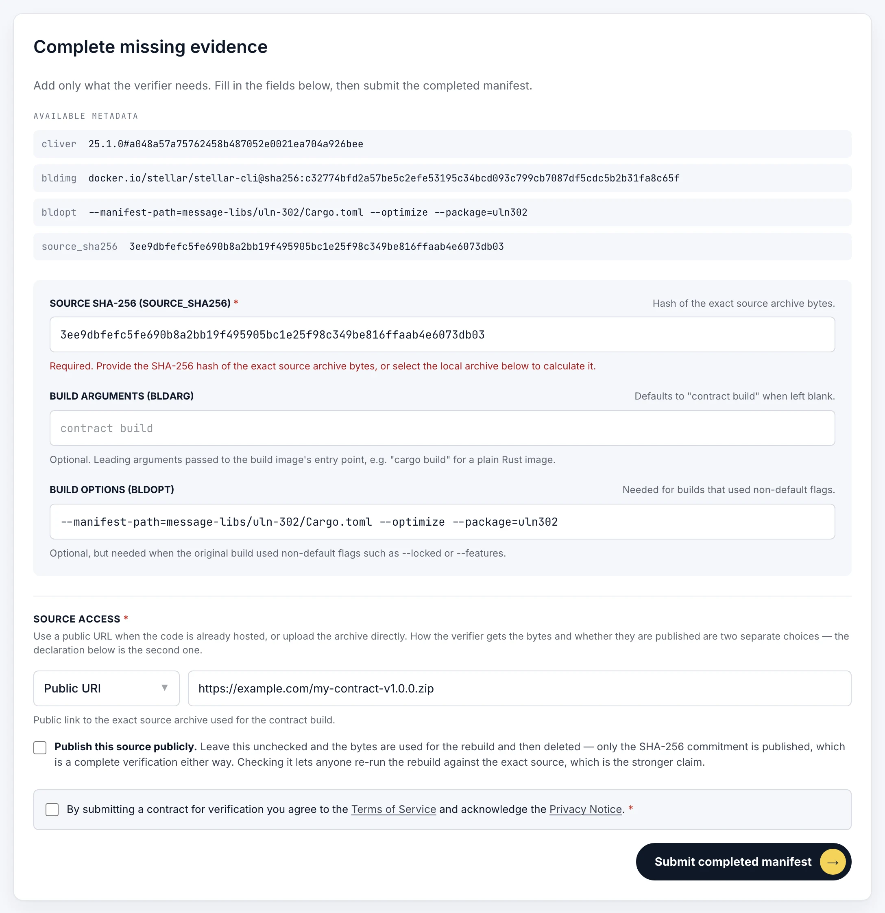
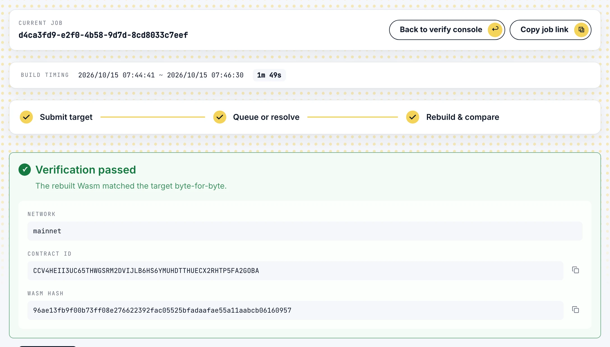
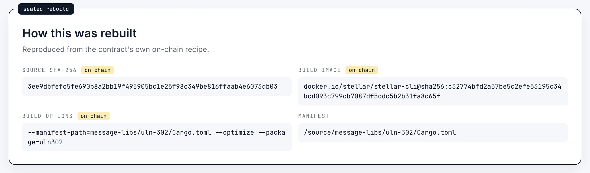
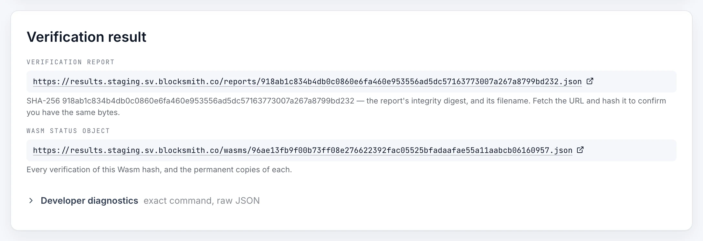

# Verify a contract in the console

Verify a deployed contract from your browser. The console checks the contract, asks only for what the
chain does not already record, submits it and follows the job to its result. It needs no account.

You need:

- the contract's network and address, or the hash of the Wasm it runs;
- its source archive: the exact gzip tarball or zip file the contract was built from, at a public URL or
  on your machine.

Open <a href="/verify">the console</a> on this deployment to begin.

## 1. Name the contract

- **Network** is the network the contract is deployed on.
- **Lookup by** chooses whether you name the contract by its address (**Contract ID**) or by its
  **Wasm hash**.

Select **Check this contract**. This only reads the chain; nothing is submitted yet.

## 2. Read the check

A green banner means this verifier can rebuild the contract, and shows the hash of the Wasm it runs.

A red banner means it cannot, and says why. Most often the contract was built without the metadata a
rebuild needs; see [Supported contracts](../introduction/supported-contracts.md). A yellow banner means
the console could not reach the verifier; that is not a verdict about your contract, so try again.

## 3. Complete the evidence

**Available metadata** is what the contract records about its own build. The console fills the fields
below from it, so for a contract built with a recent `stellar-cli` you usually add only the source.

- **Source SHA-256** is the hash of the source archive's bytes. When the contract records one, it is
  filled in, and your archive must match it.
- **Build arguments** and **build options** are what the original build ran. Leave them as filled in
  unless you know the build differed.
- **Source access** says how the verifier gets the archive:
  - **Public URI**: a link that serves the archive's bytes, not a web page about them.
  - **Upload archive**: pick the file. The console hashes it in your browser, refuses it if the hash does
    not match the one the contract records, and uploads it when you submit.
- **Publish this source publicly** decides what happens to the archive afterwards. Left unchecked, the
  verifier uses it for the rebuild, then deletes it and publishes only its hash. Checked, the archive is
  published with the result, so anyone can repeat the rebuild.

Then accept the <a href="/terms">Terms of Service</a> and acknowledge the <a href="/privacy">Privacy
Notice</a>, and select **Submit completed manifest**.

::: warning A submission from the console is published
When the rebuild reaches a verdict, matched or not, the verdict is published, and so is the source if you
chose to publish it. To try a contract without publishing anything, submit it as a dry run through the
API; see
[Submit a contract with curl](./submit-with-curl.md#_4-submit).
:::

## 4. Follow the job

The console opens the job's page, which updates by itself while the job runs.

- **Copy job link** copies the page's address. Anyone with the link can follow the job and read its
  result.
- **Build timing** counts from when the verifier accepted the submission, so it includes any time the job
  waited for a build slot.
- The three steps track the job from submission, through the queue, to the rebuild and comparison.

Jobs you submit are also listed under **Recent verification jobs** on the console, in this browser only.

## 5. Read the result

The banner gives the verdict:

- **Verification passed**: the rebuilt Wasm matched the deployed Wasm byte for byte.
- **Verification mismatch**: the rebuild ran and produced a different Wasm. Most often the archive or the
  build options are not the ones the contract was built with.
- **Anything else**: the job could not reach a verdict, and the banner says why. Look the reason up in
  [Failure codes](../api/errors.md#failure-codes).

Below it, **How this was rebuilt** shows the recipe the verifier used, and marks each value the contract
itself recorded as **on-chain**.

**Verification result** links the published record.

- **Verification report** is the full record of this verification. Its file name is its SHA-256, so you
  can check the bytes you fetch.
- **Wasm status object** lists every verification of this Wasm, by this verifier.
- **Developer diagnostics** holds the exact build command and the raw responses.

[Read a result with curl](./read-a-result.md) shows how to check this evidence yourself, and how to read
other verifiers' answers.

## 6. The build log

Only the browser that submitted the job can read its build log. The console keeps the log's token in that
browser and shows it under **Build log**; copy it if you will need the log anywhere else, because the
verifier cannot issue it again. Anyone else who opens the job link sees the result, but not the log.

The log is kept for a limited period; see [How it works](../introduction/how-it-works.md).
