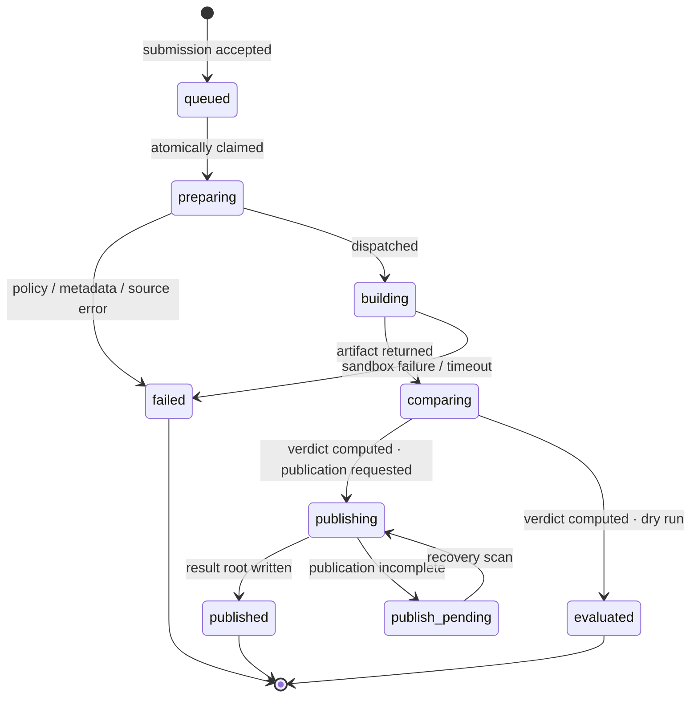

# Data and lifecycle

As built. See `Verified by:` on each claim.

The job/rebuild model: what a submission becomes, what moves it, and what is persisted. The HTTP
surface that accepts a submission is [`submission.md`](submission.md); how a rebuild is performed is
[`verification.md`](verification.md); what a verdict becomes once published is
[`published-results.md`](published-results.md).

## The central separation

A **rebuild** ("compile this source with this image and these options") and a **job**'s **verdict**
("do the bytes deployed at this target equal what that compile produced") are separate entities —
see [rule 15](../invariants.md). A rebuild is a pure function of its inputs and is cacheable; a verdict
depends on the chain at comparison time and is never cached across jobs.

Every job independently re-fetches its target's current deployed Wasm hash at comparison time and
compares it to the rebuild's own `rebuiltWasmHash` — never a value cached at submission, and never
the sandbox's self-reported hash.
Verified by: `services/orchestrator-svc/src/modules/verification-pipeline/verification-pipeline.service.ts`
(the `comparing` step), `packages/db/prisma/schema.prisma` (`Job.wasmHash` vs. `Rebuild.rebuiltWasmHash`).

Failure reasons split by scope: `source_unreachable`, `build_failed`, `build_timeout` belong to the
rebuild and propagate to every attached job; `missing_fields` and a chain-lookup `internal_error`
belong to the individual job's target resolution.
Verified by: `services/orchestrator-svc/src/modules/verification-pipeline/failure-reason.util.ts`.

## The job state machine

`published`, `evaluated`, `failed` are terminal. `evaluated` is where a dry run ends: a real build, a
real comparison, the verdict returned to the submitter, nothing written to the result root. Only
`failed` is a job failure, and job failures are never published.
Verified by: `services/orchestrator-svc/src/modules/verification-pipeline/verification-pipeline.service.ts`
(the status-transition `switch`, `advanceJob` calls at each step), `packages/db/src/jobs.repo.ts`
(`advanceJob`).

`publish_pending` is not terminal and the verdict is never recomputed while a job sits in it — only
publication retries.

The rebuild has its own bounded lifecycle: `dispatching` past its timeout releases back to `pending`;
`running` past its timeout is marked terminal `cli_failure`, since the sandbox may still be alive and
re-dispatch would duplicate a live build.
Verified by: `services/orchestrator-svc/src/modules/scheduler/rebuild-reconciler.scheduler.ts`.

## The idempotency key

Identifies a **rebuild**, not a target. Computed over content, not location — `source_sha256`,
`bldimg`, ordered `bldarg` (default `["contract", "build"]`), bytewise-sorted `bldopt`, and an
optional `metadata_replay` component when one applies — with each element length-prefixed so no two
distinct input tuples can serialise to the same byte string. Excludes network, contract ID, and Wasm
hash, which is what makes a cached rebuild reusable across targets while the verdict is recomputed
per target. `Rebuild.idempotencyKey` is unique in the schema: two rebuild rows never share a key.
Verified by: `packages/core/src/rebuild-key.ts` (`computeIdempotencyKey`), `packages/core/src/rebuild-key-test.ts`,
`packages/db/prisma/schema.prisma`.

## Deduplication and re-verification

| Rule | Behaviour |
| :---- | :---- |
| Idempotency | Identical inputs reuse the cached rebuild; the verdict is recomputed against the current request's target, evaluated across networks |
| `verified` is terminal for its inputs | A `verified` result short-circuits a further request carrying the *same* recipe, only after re-confirming the target's current deployed hash still matches |
| `mismatched` is not re-run on identical inputs | A mismatch with *different* inputs is a new job; one Wasm hash may accumulate several `mismatched` results |
| Retryable failures | Exactly `build_timeout` and `internal_error` are retryable; every other reason requires a changed input |

Verified by: `test/integration/cases/dedup/dedup-01-idempotency.spec.ts` (E2E-DEDUP-01),
`test/integration/cases/dedup/dedup-06-retryable-failures.spec.ts` (E2E-DEDUP-06).

`cli_failure` does not permanently poison a recipe: a rebuild left terminal on `cli_failure` is reset
to `pending` by the first job that observes it, compare-and-set so concurrent attachers produce one
reset, scoped to `cli_failure` only (`success` and `comparison_mismatch` are legitimate cacheable
outcomes). Every job that the rebuild had already failed re-opens with it, scoped by whether the
failure was the rebuild's or the job's own target resolution.
Verified by: `services/orchestrator-svc/src/modules/batch-events/rebuild-outcome.service.ts`,
`packages/db/src/rebuilds.repo.ts`.

Contract binding drift: when a job's freshly fetched deployed hash no longer matches the one observed
at job creation, the job still publishes its byte-level verdict through the by-hash index, but skips
writing the by-contract pointer.

## Claiming and concurrency

Job claiming out of `queued` is a single conditional write that both selects and claims — no
select-then-update window where two replicas claim the same row.
Verified by: `packages/db/src/jobs.repo.ts` (`advanceJob`).

Rebuild dispatch is guarded the same way: a compare-and-set on the rebuild's `pending` →
`dispatching` transition, so exactly one of several jobs discovering the same undispatched rebuild in
one poll tick performs it.

Recovery on restart reads durable state only: `queued` jobs are re-claimed, `publish_pending` jobs
return to `publishing`, pending-archive records are retried, and rebuilds stuck in a waiting state age
out by their timeouts.

## Retention

| Class | Disposition |
| :---- | :---- |
| Job rows, including every failed job | Retained for the verifier's operating lifetime; never published or archived |
| `source_sha256` | Retained even when the source bytes are not |
| Source submitted to a dry run | Never stored durably, whatever was declared |
| Source with a public declaration | Stored durably, served on the public API, addressed by `source_sha256` |
| Source without a public declaration | Deleted at job termination, on every terminal path |
| Submitter identity | Never collected |

Verified by: `services/orchestrator-svc/src/modules/source-resolution/source-resolution.service.ts`
(`deleteObject` on the non-public path), `test/integration/cases/src/src-03-private-source-deleted.spec.ts`
(E2E-SRC-03).

Verification is independent of storage: a submission whose source is not stored still receives a real
verdict, published like any other. A verdict is never downgraded because source became unavailable
later.
